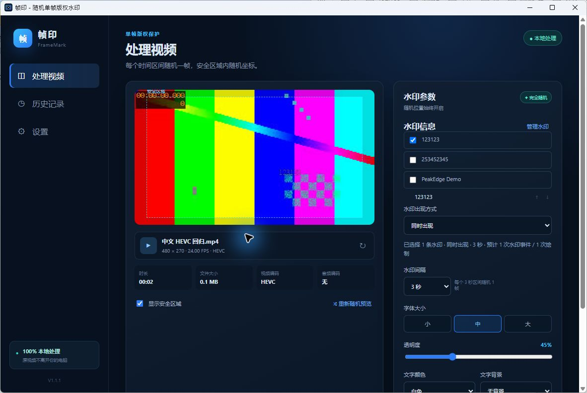
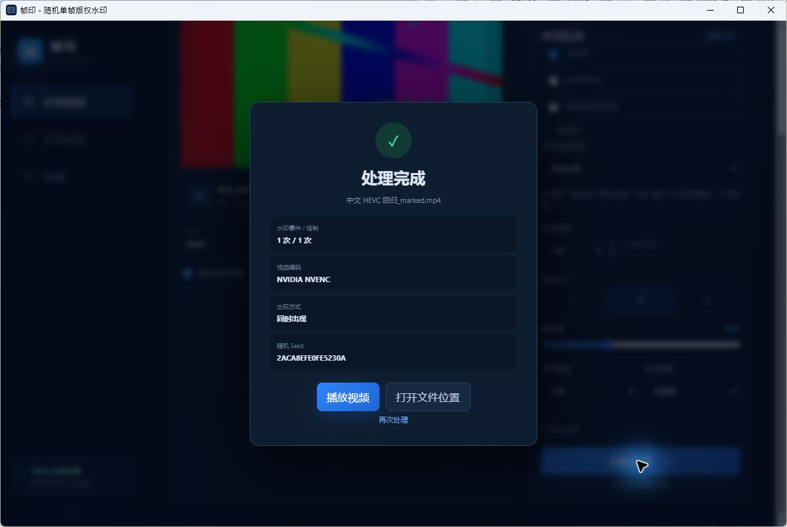

# 帧印 FrameMark — 随机单帧视频版权水印工具

[English](README.en.md) · [参与贡献](CONTRIBUTING.md) · [MIT 许可证](LICENSE)

帧印是一款开源、本地运行的桌面视频水印工具。创作者可以保存用户名、频道、
品牌、版权声明、网站地址等自由文字，在每个时间区间内随机选择一个真实视频帧，
把水印写入安全区域中的随机位置，增加批量寻找和清除版权标记的工作量。

当前版本 **1.1.2**，发行目标是 Windows 10/11 x64。macOS 尚未构建验证，属于后续计划。

## 功能

- 水印信息自由填写，支持中英文、数字、@、©、URL 和多行文本；每条最多 240 字符、8 行。
- 新增、编辑、复制、删除、上下排序；旧“平台身份”的文字和历史原样保留。
- 处理页勾选多个水印，并可调整本次使用顺序。
- **同时出现**：全部选中水印严格出现在同一个目标帧，各自随机坐标，避免重叠。
- **依次闪现**：每个目标帧显示一条，按照选择顺序循环。
- FFmpeg 实际测量文字尺寸，必要时换行、有限缩小字号；无法容纳时在编码前报错。
- 预览与输出复用事件布局和 FFmpeg 绘制代码，支持重新随机和查看下一个水印。
- 自动检测 H.264 NVENC、Intel QSV、AMD AMF；自动优先 GPU，初始化失败回退 libx264 CPU。
  当前已在 NVIDIA 机器验证；Intel/AMD 尚需对应硬件验证；VideoToolbox 预留给 macOS。
- 本地 SQLite 历史保存文字快照、顺序、模式、算法版本、Seed、事件、时间戳、帧号、坐标、字号和透明度。
- 保留进度、取消清理、音频兼容时流复制、VFR 真实帧处理、旋转处理、HDR 警告和原视频保护。
- 正式 Windows 程序无伴生控制台；FFmpeg/ffprobe 和必要安装资源随本地安装包提供。

## 工作原理

60 秒视频设置 3 秒间隔，生成 20 次水印事件。每次在对应区间内随机选择一个真实帧，
最后不足完整间隔的部分也选一帧。选择 A、B、C 三条水印时：

| 模式 | 每次事件 | 20 次事件的绘制总数 |
| --- | --- | --- |
| 同时出现 | 同帧显示 A、B、C | 60 |
| 依次闪现 | A、B、C、A…… | 20 |

依次闪现的事件数少于水印数时，靠后的水印可能不出现，界面会提示，
不会为凑齐水印而改变用户设置的频率。

水印只在目标帧合成，但整段视频会重新编码，其他画面仍会经历正常压缩。
本工具不能保证阻止所有盗搬，也不能保证水印经过重编码、帧率转换、裁剪、
丢帧或 AI 修复后仍然存在；不承诺构成法律上的版权证明。

## 真实界面

以下为 Windows 1.1.1 真实界面：HEVC 素材、原生 FFmpeg 水印预览与 NVIDIA 导出。




## 使用方法

1. 在设置中新增水印内容。
2. 拖入或选择已制作完成的视频。
3. 勾选水印，调整顺序，选择同时出现或依次闪现。
4. 设置间隔、样式和安全边距，检查预览。
5. 开始处理；界面显示实际编码器。
6. 打开新视频，保留历史以便以后按时间逐帧检查。

安装根目录有 `frame-mark.exe` 和友好的 `帧印.lnk`，均使用正式品牌图标。
也可以从开始菜单启动；删除桌面快捷方式不会删除这些入口。

## 下载与发布状态

1.1.2 为源码预发布；中文机器级安装默认系统 64 位 `Program Files\framemark`，需要管理员授权。
旧版当前用户安装需先卸载程序且不要删除用户数据；不自动跨权限迁移。
本轮尚未完成管理员安装/升级/卸载验收，官网稳定下载仍为 1.1.1。

Windows 安装包与完整对应第三方源码见 [1.1.1 Release](https://github.com/wuzhimingking-arch/FrameMark/releases/tag/v1.1.1)。安装包未进行数字签名，Windows/SmartScreen 可能提示未知发布者。

本版本用可控自建 GPLv3-or-later FFmpeg 替换旧 Gyan 二进制，公开全部实际依赖源码、构建脚本、配置、许可证和 SHA-256；旧 1.1.0 安装包不补发。详细说明见 [第三方组件说明](THIRD_PARTY_NOTICES.md) 与 [自建步骤](docs/build/FFMPEG_WINDOWS.md)。

## Windows 开发与构建

要求 Node.js **22.12+**（推荐 24）、npm、当前稳定版 Rust，以及
`x86_64-pc-windows-msvc` target。当前实测 Node 24 / Rust 1.97。
按 [Tauri 官方前置条件](https://v2.tauri.app/start/prerequisites/) 安装 Visual Studio C++ 工具、
Windows SDK 和 WebView2 Runtime。开发依赖及资源下载需要网络，视频处理完全本地进行。

```powershell
npm ci
npm run prepare:assets
npm run tauri -- dev --target x86_64-pc-windows-msvc
```

`prepare:assets` 会准备哈希固定的自建 FFmpeg 7.1.1 sidecar、Noto Sans SC 字体和许可证。
最终用户无需自行安装 FFmpeg、开发工具或配置 PATH。

```powershell
npm run build
cargo fmt --manifest-path src-tauri/Cargo.toml -- --check
cargo test --manifest-path src-tauri/Cargo.toml --lib
npm run tauri -- build --target x86_64-pc-windows-msvc
```

标准 Tauri 构建的 NSIS 安装包位于
`src-tauri/target/x86_64-pc-windows-msvc/release/bundle/nsis/`。

本项目还支持现有 LLVM/cargo-xwin 构建方式。先执行
`cargo install --locked cargo-xwin`，并把 LLVM 的
`clang.exe`、`ld.lld.exe`、`llvm-rc.exe`、`llvm-readobj.exe` 加到开发环境 PATH：

```powershell
npm run tauri:build
npm run verify:windows
```

该脚本把安装包复制到 `artifacts/windows/`。验证会检查 GUI 子系统、动态依赖、
图标、安装根目录快捷方式、开始菜单、内置资源、干净 PATH 启动及卸载。
它会实际执行机器级安装和卸载，并可能更新快捷方式，必须在管理员测试环境运行。
只读检查可用 `powershell -File scripts/verify-windows-release.ps1 -AuditOnly`，不代表安装验收。

自动测试只使用合成数据，涵盖迁移、1000 个事件的确定性/边界/碰撞、双模式 CPU/GPU、
真实解码帧、音频、VFR、旋转、中文路径和取消。GitHub CI 执行 Windows 格式、测试、
前端及安装包构建；交互式安装验收在本地完成。

## 架构与限制

Tauri 2 + 原生 TypeScript/HTML/CSS + Rust + FFmpeg/ffprobe + SQLite。
无需账户和服务器，不上传视频、水印或记录；数据和日志写入应用数据目录。
旧表原地迁移，不清库，历史文字不随保存的水印删除。

重点输入为 MP4/H.264/H.265；MOV、MKV、WebM 容器内也必须使用支持的编码。
输出固定为 H.264 MP4。兼容音频流复制，其余转 AAC；文本字幕转 MP4 文本字幕，
无法处理的字幕编码会明确失败。数据流和附件流不复制。
HDR/Dolby Vision 色彩不保证无损；不含避脸、避字幕、剪辑、Logo 或联网盗版扫描。

当前事实见 [项目上下文](docs/PROJECT_CONTEXT.md)，测试证据见 [验证记录](docs/VALIDATION.md)。

## 第三方组件与源码获取

- 随包 Gyan FFmpeg/ffprobe 7.1.1 Essentials 为 **GPL-3.0-or-later**，以独立进程调用，
  不链接进 FrameMark。[FFmpeg 核心对应提交](https://github.com/FFmpeg/FFmpeg/tree/db69d06eeeab4f46da15030a80d539efb4503ca8)。
- [源码清单](docs/compliance/ffmpeg-7.1.1/manifest.json) 提供 FFmpeg 和四个已定位库的
  源码归档 URL 与 SHA-256。它们**尚非完整对应源码包**，其余依赖、补丁和必要构建脚本仍待补齐。
- Noto Sans CJK SC 为 **SIL OFL 1.1**；Tauri、应用依赖保留各自许可，见
  [第三方声明](THIRD_PARTY_NOTICES.md)。独立进程调用不免除 FFmpeg 的再分发义务。

[1.1.0 合规审查](docs/FFMPEG_COMPLIANCE.md) 记录原安装包指纹、源码/构建对应关系、
已取得材料、测试及剩余阻塞。`npm run audit:ffmpeg` 检查本地留存材料；
退出码 2 表示完整性通过但公开分发仍被阻塞，不代表获准发布。

## 开源协议

FrameMark 自有源码、文档和项目图标采用 [MIT](LICENSE)。
FFmpeg sidecar 为 GPL-3.0-or-later，Noto 字体为 SIL OFL 1.1，各自保留许可证，
不能把全部打包组件称为 MIT。详见 [THIRD_PARTY_NOTICES.md](THIRD_PARTY_NOTICES.md)。
